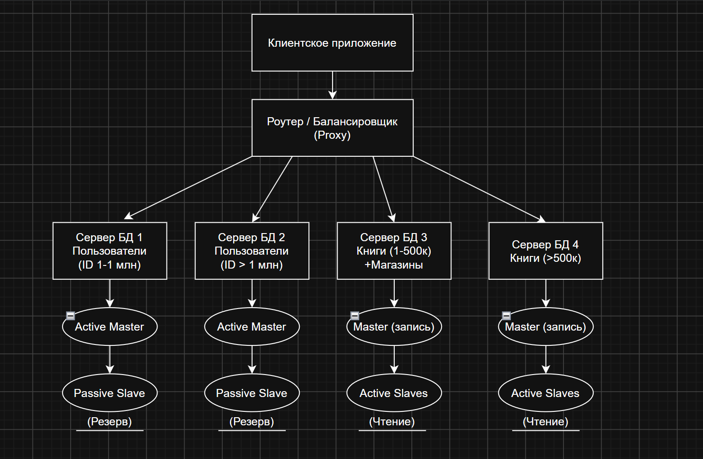

# Домашнее задание к занятию "`Репликация и масштабирование. Часть 2`" - `Павлова Алена`

### Задание 1

`Опишите основные преимущества использования масштабирования методами:
активный master-сервер и пассивный репликационный slave-сервер;
master-сервер и несколько slave-серверов;
Дайте ответ в свободной форме.`

В первом варианте, где присутствует активный Master-сервер и пассивный Slave-сервер, основное преимущество заключается в отказоустойчивости. Благодаря такой инфраструктуре при потере Master-сервера репликационный Slave-сервер станет главным (Master), что обеспечит минимальное время простоя.
Второй вариант обеспечивает сразу два преимущества: высокую отказоустойчивость и горизонтальное масштабирование операций чтения. Такая архитектура позволяет поставить перед базой балансировщик и распределить потоки запросов: все операции записи идут на Master, а запросы на чтение равномерно распределяются между несколькими Slave-серверами. Это снимает нагрузку с главного сервера и ускоряет работу системы при большом количестве пользователей.

---

### Задание 2

`Разработайте план для выполнения горизонтального и вертикального шаринга базы данных. База данных состоит из трёх таблиц:
пользователи,
книги,
магазины (столбцы произвольно).
Опишите принципы построения системы и их разграничение или разбивку между базами данных.
Пришлите блоксхему, где и что будет располагаться. Опишите, в каких режимах будут работать сервера.`

1. `Таблицы и столбцы`

Для примера возьмем базовый набор полей для каждой из трех таблиц:
Пользователи: id, имя, email, город.
Книги: id, название, автор, цена.
Магазины: id, город, адрес.

2. `Делим базу (вертикально и горизонтально)`

Дабы разгрузить базу от нагрузки и большого объема данных, используется сразу два вида шардинга:
Вертикальный шардинг (разносим разные таблицы по разным серверам):
Таблицу пользователя мы отделяем от каталога, потому что пользователи постоянно регистрируются и меняют свои данные (идет частая запись в базу). А таблицы Книги и Магазины оставили в одной связке их в основном только смотрят и ищут (идет чтение), плюс удобно сразу проверять, в каком магазине есть нужная книга.
Горизонтальный шардинг (делим большие таблицы по строкам):
Таблицу Магазины не трогали, т.к магазинов немного, она спокойно поместится целиком на одном сервере. А вот Пользователей и Книг много, поэтому делим их по id на два сервера каждую:
- Сервер БД 1: хранит пользователей с id от 1 до 1 000 000.
- Сервер БД 2: хранит пользователей с id больше 1 000 000.
- Сервер БД 3: хранит книги с id от 1 до 500 000 и всю таблицу Магазины.
- Сервер БД 4: хранит книги с id больше 500 000.

3. ` Маршрутизация и режимы работы серверов`

Между клиентским приложением и серверами БД стоит Роутер / Балансировщик (Proxy). Он перехватывает запрос, смотрит на id и отправляет сразу на нужный сервер, чтобы не дергать остальные базы впустую.
В каких режимах работают серверы:
- На серверах БД 1 и БД 2 (Пользователи) стоит схема Active Master + Passive Slave. Весь основной трафик идет на Active Master, а Passive Slave просто молча копирует данные. Он нужен для страховки: если главный сервер упадет, пассивный быстро займет его место, а еще с него удобно делать бэкапы, не тормозя работу пользователей.
- На серверах БД 3 и БД 4 (Книги и Магазины) стоит схема Master + Active Slaves. Добавлять или менять книги можно только через Master, а вот все запросы на просмотр и поиск каталога распределяются между Active Slaves, чтобы сайт выдерживал большой поток покупателей.

`

---

